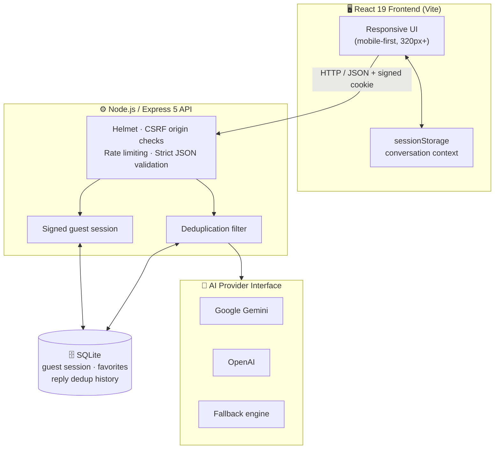

<div align="center">

# 💜 FlirtMate

### Never leave a good message on read again.

**Paste their text. Get six natural replies, each with its own vibe, in English, Telugu, Tenglish or Hinglish.**

<br />

[](https://nodejs.org/)
[](https://react.dev/)
[](https://expressjs.com/)
[](https://vitejs.dev/)
[](https://github.com/WiseLibs/better-sqlite3)

[](https://vitest.dev/)
[](https://playwright.dev/)
[](LICENSE)
[](#-privacy--data-retention)

<br />

[**Quick Start**](#-quick-start) · [**Vibes**](#-the-six-vibes) · [**Languages**](#-languages) · [**Privacy**](#-privacy--data-retention) · [**Architecture**](#-architecture) · [**Docs**](#-further-documentation)

</div>

---

## 📑 Table of Contents

- [✨ What is FlirtMate?](#-what-is-flirtmate)
- [🌟 Highlights](#-highlights)
- [🎭 The Six Vibes](#-the-six-vibes)
- [🗣️ Languages](#️-languages)
- [🌶️ Intensity Levels](#️-intensity-levels)
- [🏗️ Architecture](#️-architecture)
- [🚀 Quick Start](#-quick-start)
- [⚙️ Scripts](#️-scripts)
- [🔒 Privacy & Data Retention](#-privacy--data-retention)
- [🛡️ Security](#️-security)
- [🧪 Testing](#-testing)
- [📖 Further Documentation](#-further-documentation)
- [📄 License](#-license)

---

## ✨ What is FlirtMate?

Sometimes you know exactly how you feel but not how to say it. FlirtMate reads the message you received, understands the moment, and gives you **six distinct reply options**, each with a different flavor, so you can pick the one that sounds like *you*.

It doesn't spit out generic pickup lines. Every reply is grounded in what the other person actually said, stays respectful and **PG-13**, and never pressures anyone.

> **Illustrative example**
>
> **They sent:** *"Just got back from the hills, so tired but it was so worth it 😅"*
>
> | Vibe | Sample reply |
> | :--- | :--- |
> | 🌸 Cute | "Go rest, hill explorer. Tell me everything when you wake up?" |
> | 🎯 Playful | "Tired but still smiling about it? Suspicious. What are you hiding up there?" |
> | 😂 Funny | "Your legs filed a complaint, but your Instagram is about to say otherwise." |
>
> *These samples are for illustration only. Real output depends on your message, language, intensity and conversation context.*

---

## 🌟 Highlights

| | Feature | Details |
| :-: | :--- | :--- |
| 🎭 | **Six signature vibes** | Cute, Playful, Smooth, Bold, Romantic and Funny: six angles for every message |
| 🗣️ | **Native cultural styles** | English, Telugu (తెలుగు), Tenglish and Hinglish that read the way people actually text |
| 🌶️ | **Intensity control** | Mild, Balanced or Spicy, so the tone matches the relationship |
| 🧵 | **Conversation threading** | Remembers up to 5 recent exchanges in your tab so follow-ups make sense |
| 🔐 | **Privacy first** | Incoming messages never touch the server database or disk |
| ♻️ | **Smart deduplication** | A sliding window stops the same suggestions from coming back |
| 🤖 | **Dual AI providers** | Works with **Google Gemini** (`@google/genai`) and **OpenAI** (`openai`) |
| 🛡️ | **Production-grade security** | Signed HttpOnly cookies, CSRF protection, Helmet, rate limiting and bundle leak audits |
| 📱 | **Mobile-first UI** | Responsive design, tested down to 320px |

---

## 🎭 The Six Vibes

Every message gets one reply per vibe, so you always have a range to choose from.

| Vibe | Style | Best when |
| :--- | :--- | :--- |
| 🌸 **Cute** | Soft, sweet, warm, endearing | You want to be gentle and affectionate without it feeling intense |
| 🎯 **Playful** | Light teasing, witty banter | You want to keep the conversation fun and sparky |
| ✨ **Smooth** | Confident, calm, charming | You want to come across as effortlessly charismatic |
| 🔥 **Bold** | Direct, clear interest | An opening is there and you want to make your interest known |
| 🌹 **Romantic** | Sincere, heartfelt, tender | You want a meaningful connection rooted in the actual moment |
| 😂 **Funny** | Quick humor, situational jokes | You want laughs tied directly to their point |

> **Ground rules for every reply:** no cheesy pickup lines, no pressure, strictly PG-13.

---

## 🗣️ Languages

| Style | Script | Description |
| :--- | :--- | :--- |
| **English** | Latin | Natural, conversational English |
| **Telugu** | తెలుగు | Native Telugu script |
| **Tenglish** | Latin | Telugu written in English letters, the way people really text |
| **Hinglish** | Latin | Hindi written in English letters |

---

## 🌶️ Intensity Levels

| Level | Feel |
| :--- | :--- |
| 🌱 **Mild** | Light, friendly and low-pressure |
| ⚖️ **Balanced** | Warm with a clear touch of flirtation |
| 🌶️ **Spicy** | Confident and more forward, still PG-13 |

---

## 🏗️ Architecture



| Layer | Technology |
| :--- | :--- |
| **Frontend** | React 19, Vite, pure CSS, adaptive mobile-first design |
| **Backend** | Express 5 on Node.js 22.12+ / 24, Helmet, `express-rate-limit` |
| **Database** | Local SQLite via `better-sqlite3`, with automated retention and cleanup sweeps |
| **AI engines** | Official `@google/genai` (Gemini) and `openai` (GPT) SDKs |

---

## 🚀 Quick Start

### Prerequisites

- **Node.js** `v22.12.0` or higher (tested on Node 24)
- **npm** (bundled with Node.js)
- **An API key** from [Google AI Studio](https://aistudio.google.com/) or the [OpenAI Platform](https://platform.openai.com/)

### 1️⃣ Clone & install

```bash
git clone https://github.com/ssreeshanth/fm_codex.git
cd fm_codex
npm install
```

### 2️⃣ Configure your environment

```bash
# macOS / Linux
cp .env.example .env

# Windows PowerShell
Copy-Item .env.example .env
```

Then open `.env` and pick a provider:

<details open>
<summary><b>Option A: Google Gemini (recommended)</b></summary>

```env
AI_PROVIDER=gemini
GEMINI_API_KEY=your_actual_gemini_api_key_here
GEMINI_MODEL=gemini-2.5-flash
```

</details>

<details>
<summary><b>Option B: OpenAI</b></summary>

```env
AI_PROVIDER=openai
OPENAI_API_KEY=your_actual_openai_api_key_here
OPENAI_MODEL=gpt-4o-mini
```

</details>

> ⚠️ **Never commit your `.env` file.** Keep API keys out of version control.

### 3️⃣ Run it

```bash
npm run start:all
```

Open **http://localhost:5173** and paste your first message. 💜

---

## ⚙️ Scripts

| Command | What it does |
| :--- | :--- |
| `npm run start:all` | 🚀 Runs the full application (default shortcut) |
| `npm run dev` | Starts the Vite dev server with the dev API proxy mounted |
| `npm run server` | Starts the standalone Express server on port `4173` |
| `npm run build` | Compiles production assets into `dist/` |
| `npm start` | Runs the production server serving the built assets |
| `npm test` | Runs unit, integration and DOM tests (Vitest) |
| `npm run test:e2e` | Runs end-to-end browser journeys (Playwright) |
| `npm run test:live` | Runs live provider validation (requires an API key) |
| `npm run check` | Runs the security scan, bundle size check and secret leak prevention |

---

## 🔒 Privacy & Data Retention

FlirtMate is built so that **the message you received is never stored on the server.**

### What lives where

| Data | Where it lives | How long |
| :--- | :--- | :--- |
| 📩 **Incoming messages** | Browser tab `sessionStorage` only | Until the tab closes or you start a new conversation |
| ✍️ **Your conversation context** (last 5 exchanges) | Browser tab `sessionStorage` only | Until the tab closes or you start a new conversation |
| 🧠 **Generated reply candidates** | Local SQLite, for deduplication | Unstarred items expire after **90 days**, capped at **500 per client** |
| ⭐ **Starred favorites** | Local SQLite | Until you remove them |
| 🍪 **Guest session** | Signed `HttpOnly`, `SameSite=Strict` cookie | Random token, no email or phone number required |

### Your controls

- 🗑️ **Purge everything** (history and favorites) with one click, any time.
- 🆕 **Start a new conversation** to clear the tab's session context immediately.
- 🙈 **No account needed.** There is no email, phone number or persistent identity.

---

## 🛡️ Security

- **Signed guest sessions** with `HttpOnly` and `SameSite=Strict` cookies
- **CSRF protection** through origin validation
- **Helmet** security headers
- **Rate limiting** on the API
- **Strict JSON validation** on every request
- **Bundle leakage auditing** (`npm run check`) to keep secrets and prompts out of the client build

---

## 🧪 Testing

```bash
npm test            # unit, integration and DOM tests
npm run test:e2e    # Playwright browser journeys
npm run check       # security scan, bundle size and secret leak audits
```

---

## 📖 Further Documentation

| Document | What's inside |
| :--- | :--- |
| 📘 [DEPLOYMENT.md](DEPLOYMENT.md) | Production setup, TLS reverse proxy, persistent disk volumes and secrets management |
| 📗 [MANUAL.md](MANUAL.md) | Detailed user manual, feature guide and operational best practices |

---

## 📄 License

Released under the [MIT License](LICENSE).

<div align="center">

<br />

**Made with 💜 for everyone who's ever stared at a "hey 😊" wondering what to say.**

</div>
# FlirtmAte

